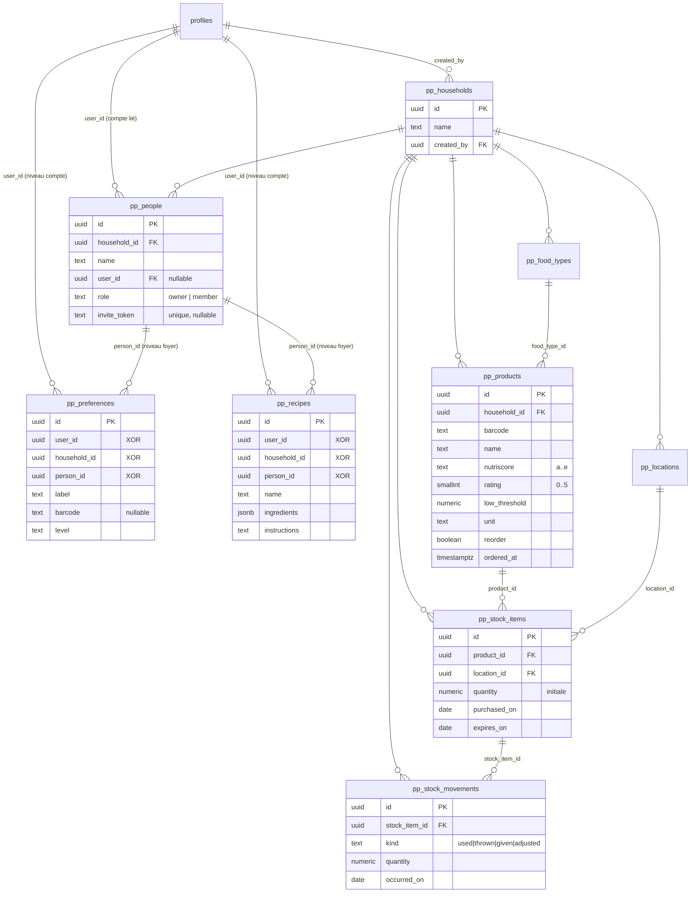

# Base de données

Postgres hébergé par Supabase, **partagé avec l'application « Pas ce soir »**.

Migrations de l'application (dans l'ordre, dans le SQL Editor, **après** celles de Pas ce soir) :

| Fichier | Contenu |
|---|---|
| [`20261014100000_popotte_init.sql`](../supabase/migrations/20261014100000_popotte_init.sql) | Schéma initial |
| [`20261015000000_preferences_barcode.sql`](../supabase/migrations/20261015000000_preferences_barcode.sql) | Code-barres des préférences d'aliments |
| [`20261015120000_products_reorder.sql`](../supabase/migrations/20261015120000_products_reorder.sql) | Produits à commander (`reorder`, `ordered_at`) |

Une migration qui ajoute une colonne synchronisée doit être exécutée **avant** le déploiement de l'application qui l'utilise.

## Sommaire

1. [Périmètre partagé](#1-périmètre-partagé)
2. [Modèle de données](#2-modèle-de-données)
3. [Tables](#3-tables)
4. [Fonctions](#4-fonctions)
5. [Règles métier (triggers)](#5-règles-métier-triggers)
6. [Sécurité (RLS et droits)](#6-sécurité-rls-et-droits)
7. [Cycle de vie des données](#7-cycle-de-vie-des-données)
8. [Requêtes utiles](#8-requêtes-utiles)

---

## 1. Périmètre partagé

| Objet | Propriétaire | Usage dans Popotte & Placard |
|---|---|---|
| `auth.users` | Supabase | Comptes (communs aux deux apps) |
| `public.profiles` | Pas ce soir | Nom affiché ; **+1 politique de lecture** ajoutée par Popotte |
| `public.app_admins`, `public.is_app_admin()` | Pas ce soir | Administrateurs (communs) |
| `public.app_invites`, `app_invite_is_valid()` | Pas ce soir | Invitations à créer un compte (communes) |
| `public.signup_allowlist` | Pas ce soir | Emails autorisés à s'inscrire sans invitation |
| Triggers `guard_signup`, `handle_new_user` sur `auth.users` | Pas ce soir | Contrôle d'inscription, création du profil |
| Tables `pp_*`, fonctions `pp_*` | **Popotte & Placard** | Tout le reste |

Popotte & Placard ne modifie aucun objet de Pas ce soir ; il ajoute seulement la politique `profils visibles : co-membres d'un foyer` sur `profiles`.

Pour désigner un administrateur :

```sql
insert into public.app_admins (user_id)
select id from auth.users where email = '<email>';
```

## 2. Modèle de données



### Principes

- **Identifiants UUID générés par le client** (création hors ligne).
- **`updated_at` horodaté par le serveur** (trigger) : base des curseurs de synchronisation.
- **Suppression douce** : `deleted_at` sur toutes les tables `pp_*`. Aucune suppression physique depuis l'application.
- **Stock en ajout seul** : la quantité d'un lot n'est jamais décrémentée ; le restant se calcule : `quantity − Σ pp_stock_movements.quantity` (mouvements non supprimés).
- **Goûts à deux niveaux** :
  - *compte* : `user_id` renseigné, `household_id` et `person_id` vides — visibles dans tous les foyers où le compte est lié ;
  - *foyer* : `household_id` + `person_id` renseignés, `user_id` vide — personne sans compte, ou complément propre au foyer.

## 3. Tables

Colonnes communes à toutes les tables `pp_*` : `created_at timestamptz not null default now()`, `updated_at timestamptz not null default now()`, `deleted_at timestamptz` (sauf mention).

### `pp_households` — foyers

| Colonne | Type | Contraintes / défaut | Description |
|---|---|---|---|
| `id` | uuid | PK, `gen_random_uuid()` | |
| `name` | text | not null | Nom du foyer |
| `created_by` | uuid | → `profiles(id)` **on delete set null**, défaut `auth.uid()` | Créateur (propriétaire) ; forcé à l'utilisateur connecté à l'insertion, immuable ensuite |

### `pp_people` — personnes d'un foyer

| Colonne | Type | Contraintes / défaut | Description |
|---|---|---|---|
| `id` | uuid | PK | |
| `household_id` | uuid | not null → `pp_households` on delete cascade | Immuable |
| `name` | text | not null | Prénom |
| `user_id` | uuid | → `profiles` **on delete set null** | Compte lié (= accès au foyer) |
| `role` | text | `owner` \| `member`, défaut `member` | Immuable après création |
| `invite_token` | text | unique | Lien d'invitation en cours (usage unique) |

Index :
- `pp_people_household_updated_idx (household_id, updated_at)` ;
- `pp_people_user_idx (user_id)` partiel ;
- **`pp_people_one_link_per_household`** unique `(household_id, user_id)` où `user_id is not null and deleted_at is null` : un compte n'est lié qu'à une personne par foyer.

### `pp_locations` — rangements

| Colonne | Type | Contraintes / défaut | Description |
|---|---|---|---|
| `id` | uuid | PK | |
| `household_id` | uuid | not null → `pp_households` cascade | |
| `label` | text | not null | Frigo, Congélateur… |
| `icon` | text | not null, défaut `''` | Nom d'icône Lucide (`i-lucide-…`) |
| `position` | integer | not null, défaut 0 | Ordre d'affichage |

`deleted_at` = archivé (masqué des choix, toujours affiché sur les lots existants).

### `pp_food_types` — types d'aliments

Identique à `pp_locations`, sans `icon`.

### `pp_products` — catalogue du foyer

| Colonne | Type | Contraintes / défaut | Description |
|---|---|---|---|
| `id` | uuid | PK | |
| `household_id` | uuid | not null → `pp_households` cascade | |
| `barcode` | text | | Code EAN/UPC |
| `name` | text | not null, non vide | Seul champ obligatoire |
| `brand`, `description`, `ingredients` | text | not null, défaut `''` | `ingredients` = composition |
| `nutriscore` | text | `a`…`e` ou null | |
| `image_url` | text | | Photo Open Food Facts |
| `food_type_id` | uuid | → `pp_food_types` on delete set null | |
| `unit` | text | not null, défaut `pièce` | Unité de toutes les quantités du produit |
| `rating` | smallint | 0 à 5, défaut 0 | 0 = non favori |
| `low_threshold` | numeric | ≥ 0, défaut 1 | Seuil « bientôt en rupture » (favoris et produits à commander) |
| `reorder` | boolean | not null, défaut `false` | À commander quand épuisé (écran *À commander*) |
| `ordered_at` | timestamptz | | Marqué « commandé » ; sans effet dès qu'un lot du produit est créé après cette date |

Index : `(household_id, updated_at)`, `(household_id, barcode)` partiel.

### `pp_stock_items` — lots

| Colonne | Type | Contraintes / défaut | Description |
|---|---|---|---|
| `id` | uuid | PK | |
| `household_id` | uuid | not null → `pp_households` cascade | |
| `product_id` | uuid | not null → `pp_products` cascade | |
| `location_id` | uuid | → `pp_locations` on delete set null | Rangement |
| `quantity` | numeric | not null, ≥ 0 | Quantité **initiale** |
| `purchased_on` | date | not null, défaut `current_date` | |
| `expires_on` | date | | Péremption |
| `note` | text | not null, défaut `''` | |
| `created_by` | uuid | → `profiles` on delete set null | Forcé à l'utilisateur connecté |

### `pp_stock_movements` — sorties et ajustements

| Colonne | Type | Contraintes / défaut | Description |
|---|---|---|---|
| `id` | uuid | PK | |
| `household_id` | uuid | not null → `pp_households` cascade | |
| `stock_item_id` | uuid | not null → `pp_stock_items` cascade | |
| `kind` | text | `used` \| `thrown` \| `given` \| `adjusted` | Utilisé, jeté, offert, correction d'inventaire |
| `quantity` | numeric | not null | Quantité retirée ; **négative** pour un ajustement à la hausse |
| `occurred_on` | date | not null, défaut `current_date` | Date de la sortie (modifiable à la saisie) |
| `recipe_name` | text | | Recette réalisée |
| `note` | text | not null, défaut `''` | |
| `created_by` | uuid | → `profiles` on delete set null | Forcé à l'utilisateur connecté |

`deleted_at` = sortie annulée (la quantité revient dans le stock).

### `pp_preferences` — préférences d'aliments

| Colonne | Type | Contraintes / défaut | Description |
|---|---|---|---|
| `id` | uuid | PK | |
| `user_id` | uuid | → `profiles` cascade | Niveau compte |
| `household_id` | uuid | → `pp_households` cascade | Niveau foyer |
| `person_id` | uuid | → `pp_people` cascade | Niveau foyer |
| `label` | text | not null, non vide | Aliment |
| `barcode` | text | 8 à 14 chiffres ou null | Saisie par scan : correspondance exacte avec le produit de même code-barres |
| `level` | text | `love` \| `like` \| `dislike` \| `allergy` | |

Contrainte `pp_preferences_owner` : **soit** `user_id` seul, **soit** `household_id` + `person_id` (sans `user_id`).

Index partiels : `(user_id, updated_at)`, `(household_id, updated_at)`.

### `pp_recipes` — recettes préférées

Mêmes colonnes de rattachement et même contrainte (`pp_recipes_owner`) que `pp_preferences`, plus :

| Colonne | Type | Contraintes / défaut | Description |
|---|---|---|---|
| `name` | text | not null, non vide | |
| `ingredients` | jsonb | not null, tableau, défaut `[]` | `[{ "name": "Tomate", "quantity": 3, "unit": "pièce" }]` (`quantity` peut être `null`, `unit` vide) |
| `instructions` | text | not null, défaut `''` | Texte libre |

## 4. Fonctions

Toutes en `security definer` avec `search_path = public`, exécutables par `authenticated` uniquement.

### Fonctions utilisées par la RLS

| Fonction | Renvoie vrai si… |
|---|---|
| `pp_is_member(household)` | l'utilisateur est lié à une personne non supprimée du foyer, **ou** en est le créateur (indispensable pendant la synchro d'un foyer créé hors ligne, avant l'envoi de sa personne) |
| `pp_is_owner(household)` | l'utilisateur est lié à une personne `owner` du foyer, ou en est le créateur |
| `pp_shares_household_with(user)` | l'utilisateur et `user` sont liés à des personnes d'un même foyer non supprimé |
| `pp_person_in_household(person, household)` | la personne appartient bien au foyer |

### RPC appelées par l'application

| Fonction | Rôle | Erreurs |
|---|---|---|
| `pp_invite_preview(token) → (household_name, person_name)` | Aperçu d'une invitation valide (personne non supprimée, sans compte, foyer non supprimé) | Aucune ligne si invalide |
| `pp_accept_invite(token) → household_id` | Lie le compte connecté à la personne et efface le jeton (usage unique) | `P0002` lien invalide ou déjà utilisé ; `P0001` déjà membre du foyer |
| `pp_leave_household(household)` | Délie le compte de sa personne dans le foyer (la personne reste) | `P0001` le propriétaire ne peut pas quitter |

Ces deux dernières positionnent la variable de transaction `pp.trusted = on` pour passer le contrôle du trigger `pp_guard_person`. Elle n'est pas positionnable depuis l'API (PostgREST n'expose pas `set_config`).

### Fonctions de trigger

| Fonction | Tables | Effet |
|---|---|---|
| `pp_touch()` | `pp_people`, `pp_locations`, `pp_food_types`, `pp_products`, `pp_preferences`, `pp_recipes` | `updated_at = now()` ; `created_at` immuable |
| `pp_touch_author()` | `pp_households`, `pp_stock_items`, `pp_stock_movements` | idem + `created_by = auth.uid()` à l'insertion, immuable ensuite (sauf mise à `null` par la cascade de suppression de compte) |
| `pp_guard_household()` | `pp_households` (update) | Seul le propriétaire peut modifier `deleted_at` |
| `pp_guard_person()` | `pp_people` (insert, update) | Voir § 5 |

## 5. Règles métier (triggers)

### `pp_guard_person` — lien personne ↔ compte

Le lien d'un compte donne accès au foyer et à ses goûts de compte : il ne peut pas être posé librement par l'API.

| Opération | Autorisée si |
|---|---|
| Insertion avec `user_id` / `role = owner` | `user_id = auth.uid()` **et** l'utilisateur est le créateur du foyer (sa propre personne à la création) |
| Insertion avec `invite_token` | propriétaire |
| Modification de `household_id` ou `role` | jamais |
| Modification de `invite_token` | propriétaire |
| `user_id` → autre compte | jamais (uniquement `pp_accept_invite`) |
| `user_id` → null | propriétaire, pour une personne non propriétaire (retrait d'accès) ; ou `pp_leave_household` |
| Suppression (`deleted_at`) d'une personne liée | propriétaire, pour une personne non propriétaire ; `user_id` et `invite_token` sont alors vidés automatiquement |
| Toute opération | dans `pp_accept_invite` / `pp_leave_household` (`pp.trusted`) |
| `user_id` → null en cascade | suppression du compte (`pg_trigger_depth() > 1`), y compris depuis Pas ce soir |

Rappel Postgres utile pour la synchro : lors d'un `INSERT … ON CONFLICT DO UPDATE`, les triggers `BEFORE INSERT` s'exécutent sur la ligne proposée **avant** la détection du conflit. C'est pourquoi le client n'envoie jamais `user_id` / `role` / `invite_token` d'une personne, sauf pour la personne du créateur.

### `pp_touch_author` et upsert

Lors d'un upsert, `created_by` est d'abord forcé à l'utilisateur connecté (ce qui satisfait la politique d'insertion `created_by = auth.uid()` des foyers), puis restauré à sa valeur d'origine si l'upsert aboutit à une mise à jour.

## 6. Sécurité (RLS et droits)

RLS activée sur toutes les tables `pp_*`. Droits accordés à `authenticated` : `select, insert, update` (jamais `delete` : suppression douce uniquement). Aucun droit pour `anon`.

| Table | Lecture | Insertion | Modification |
|---|---|---|---|
| `pp_households` | créateur ou membre | `created_by = auth.uid()` | membre (suppression : propriétaire, via trigger) |
| `pp_people`, `pp_locations`, `pp_food_types`, `pp_products`, `pp_stock_items`, `pp_stock_movements` | membre du foyer | membre du foyer | membre du foyer (+ trigger pour `pp_people`) |
| `pp_preferences`, `pp_recipes` | les miennes (`user_id = moi`) ; celles des comptes qui partagent un foyer avec moi ; celles des foyers dont je suis membre | `user_id = moi` ; ou niveau foyer : membre **et** personne du foyer | les miennes ; ou niveau foyer : membre (avec la même vérification de personne) |
| `profiles` (ajout) | co-membres d'un foyer | — | — |

Conséquences :
- les goûts **de compte** d'un autre membre sont visibles mais **non modifiables** ;
- un membre qui quitte un foyer perd immédiatement l'accès à ses données et aux goûts de compte des autres membres ;
- une ligne refusée par la RLS renvoie `42501`, ce que la synchro gère en isolant la ligne.

La migration a été vérifiée par un jeu de 39 scénarios (Postgres local avec un `auth.uid()` simulé) : création hors ligne et upsert, isolement entre foyers, invitations à usage unique, droits propriétaire / membre, goûts de compte en lecture seule, départ et retrait d'accès, suppression de compte.

## 7. Cycle de vie des données

| Événement | Effet en base |
|---|---|
| Création d'un foyer (client) | `pp_households` + personne propriétaire liée + 3 rangements + 12 types d'aliments |
| Suppression d'un foyer | `deleted_at` sur le foyer ; les lignes rattachées restent mais ne sont plus synchronisées (purge locale côté client) |
| Membre qui quitte / retrait d'accès | `pp_people.user_id = null` ; la personne et ses goûts de foyer restent |
| Personne retirée du foyer | `deleted_at` sur la personne ; ses goûts de foyer ne sont plus affichés |
| Suppression d'un compte (depuis Pas ce soir) | `profiles` supprimé → goûts de compte supprimés (cascade) ; personnes déliées ; `created_by` mis à null (foyers, lots, sorties) ; foyers conservés |
| Suppression d'un produit / lot / sortie | `deleted_at` (annulable) |
| Archivage d'un rangement / type | `deleted_at` ; les produits et lots gardent leur référence |

Aucune purge physique automatique n'est prévue. Pour nettoyer les foyers supprimés :

```sql
-- supprime physiquement (cascade) les foyers supprimés depuis plus de 90 jours
delete from public.pp_households
where deleted_at < now() - interval '90 days';
```

## 8. Requêtes utiles

Stock restant par lot d'un foyer :

```sql
select p.name, i.id as lot, i.expires_on,
       i.quantity - coalesce(sum(m.quantity) filter (where m.deleted_at is null), 0) as restant,
       p.unit
from pp_stock_items i
join pp_products p on p.id = i.product_id
left join pp_stock_movements m on m.stock_item_id = i.id
where i.household_id = '<foyer>' and i.deleted_at is null and p.deleted_at is null
group by p.name, i.id, i.expires_on, i.quantity, p.unit
having i.quantity - coalesce(sum(m.quantity) filter (where m.deleted_at is null), 0) > 0
order by i.expires_on nulls last;
```

Membres d'un foyer et comptes liés :

```sql
select pe.name, pe.role, pr.display_name, u.email
from pp_people pe
left join profiles pr on pr.id = pe.user_id
left join auth.users u on u.id = pe.user_id
where pe.household_id = '<foyer>' and pe.deleted_at is null;
```

Réattribuer un foyer sans propriétaire (compte du créateur supprimé) :

```sql
-- à exécuter dans le SQL Editor ; pp.trusted lève le contrôle de pp_guard_person.
-- Le rôle « owner » suffit (pp_is_owner) : created_by reste immuable (pp_touch_author).
begin;
select set_config('pp.trusted', 'on', true);
update public.pp_people set role = 'owner'
where household_id = '<foyer>' and user_id = '<nouveau user_id>' and deleted_at is null;
commit;
```

Gaspillage sur 30 jours par foyer :

```sql
select household_id, kind, count(*), sum(quantity)
from pp_stock_movements
where deleted_at is null and kind <> 'adjusted' and occurred_on >= current_date - 30
group by household_id, kind
order by household_id, kind;
```
